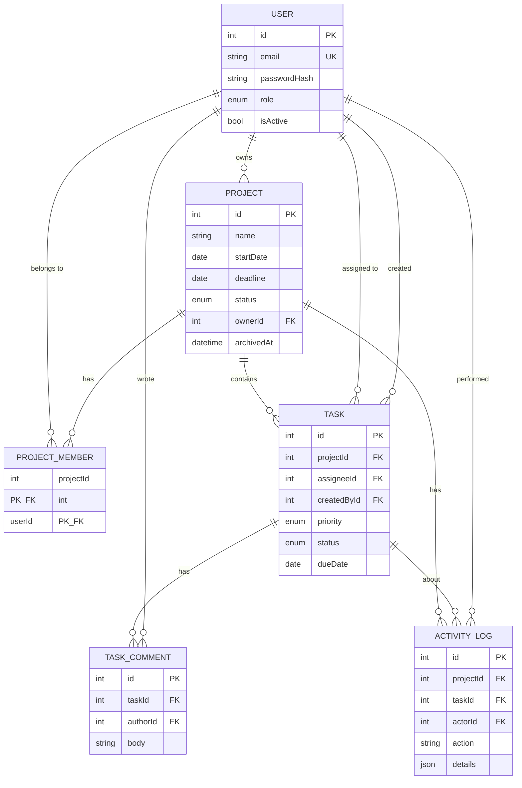

# Project & Team Management System

A full-stack web application where an organization can manage projects, assign tasks to team members, track progress and monitor deadlines. Built for the *Web Developer – Advanced Project-Based Assessment*.

- **Frontend:** React 18 + TypeScript + Vite
- **Backend:** Node.js + Express + TypeScript
- **Database:** PostgreSQL, accessed through the Prisma ORM
- **Auth:** JWT stored in an `httpOnly` cookie, passwords hashed with bcrypt, role-based access control enforced on the backend
- **Tests:** Vitest + Supertest (integration tests against a real test database)

> **AI assistance disclosure:** as allowed by the assignment rules (section 13), I used an AI coding assistant (Claude) while building this project. I reviewed, ran and understand all of the code, and I am happy to walk through any part of it.

---

## Table of contents

1. [Features](#1-features)
2. [Architecture and design decisions](#2-architecture-and-design-decisions)
3. [Getting started](#3-getting-started)
4. [Database design](#4-database-design)
5. [Roles and permissions](#5-roles-and-permissions)
6. [API documentation](#6-api-documentation)
7. [Security](#7-security)
8. [Performance](#8-performance)
9. [Testing](#9-testing)
10. [Deployment](#10-deployment)
11. [Project structure](#11-project-structure)
12. [Screenshots](#12-screenshots)
13. [Known limitations and future improvements](#13-known-limitations-and-future-improvements)

---

## 1. Features

| Area | What is implemented |
|---|---|
| Authentication | Register, login, logout, session restore on page refresh, password hashing, protected routes (frontend) and protected APIs (backend), login brute-force protection |
| Authorization | 3 roles (Admin, Project Manager, Team Member) enforced in the backend services; the UI only mirrors it |
| Projects | Create, edit, view with progress, status (Planning / Active / On Hold / Completed), team assignment, archive/restore, admin-only permanent delete, search, status filter, pagination |
| Tasks | Create, view, edit, delete, assign/reassign, status updates, priority; filter by project / assignee / priority / status / overdue; title search; sorting; pagination; due-date and required-field validation |
| Dashboard | Totals, active/completed projects, tasks by status, overdue tasks, my open tasks, completion % per project — all calculated from database records and scoped to what the user may see |
| Collaboration | Comments on tasks (author + timestamp) and an activity history for key actions, shown on project and task pages |
| User management | Admins can create users, change roles, deactivate/reactivate accounts |
| UI | Responsive (desktop, tablet, phone), reusable components, loading / empty / success / error states |

## 2. Architecture and design decisions

```
Browser (React SPA)  ──HTTP/JSON──▶  Express API  ──Prisma──▶  PostgreSQL
```

**Backend layering** (`server/src`):

| Layer | Folder | Responsibility |
|---|---|---|
| Routes | `routes/` | Thin HTTP layer: parse + validate input, call a service, send the response |
| Validators | `validators/` | Zod schemas = the single source of truth for request shapes and the inferred TypeScript types |
| Services | `services/` | Business rules: permissions, validation that needs the DB, transactions, activity logging |
| Data access | Prisma client (`lib/prisma.ts`) | Typed queries; schema in `prisma/schema.prisma` |
| Middleware | `middleware/` | `authenticate`, `requireRole`, central error handler |

Why these choices:

- **TypeScript on both sides** – type safety catches mistakes early and documents the data shapes.
- **PostgreSQL + Prisma** – real relational integrity (foreign keys, composite keys, enums, indexes), typed queries, and versioned migrations.
- **JWT in an httpOnly cookie** (instead of localStorage) – JavaScript running in the page can never read the token, which removes the most common token-theft path (XSS). `SameSite=Lax` blocks the cookie on cross-site requests (CSRF), and all mutating endpoints require a JSON body.
- **The user is re-loaded from the database on every request** – role changes and deactivation take effect immediately instead of waiting for a token to expire (cost: one primary-key lookup per request).
- **One central `loadProjectAccess()` function** (`services/permissions.service.ts`) – every project/task operation passes through the same permission check, so rules cannot drift between endpoints.
- **Zod for validation** – one place defines what a valid request is; validation failures become a uniform `400` response.
- **Express serves the built React app in production** – a single deployment on a single origin, so the auth cookie needs no cross-site configuration.
- **Plain `fetch` + a small `useFetch` hook** on the frontend – few dependencies, easy to read. (React Query would be a good next step for caching.)

**Consistent API format**

```jsonc
// success
{ "data": { ... } }
{ "data": [ ... ], "meta": { "page": 1, "pageSize": 10, "total": 42, "totalPages": 5 } }

// error (always this shape)
{ "error": { "code": "VALIDATION_ERROR", "message": "Invalid request data",
             "details": [ { "path": "title", "message": "Title must be at least 3 characters" } ] } }
```

## 3. Getting started

### Prerequisites

- Node.js 20 or newer (`node -v`)
- Docker Desktop (easiest way to get PostgreSQL) **or** a local PostgreSQL 14+ installation
- Git

### Step 1 – Clone and install

```bash
git clone <your-repo-url>
cd project-team-manager
npm run install:all          # installs server/ and client/ dependencies
```

### Step 2 – Start PostgreSQL

```bash
docker compose up -d
```

This starts PostgreSQL on port 5432 and creates two databases: `pm_system` (development) and `pm_system_test` (tests).
Without Docker, create those two databases yourself and adjust the connection strings below.

### Step 3 – Configure environment variables

```bash
cd server
cp .env.example .env          # Windows PowerShell: copy .env.example .env
cp .env.test.example .env.test
```

Edit `server/.env` and set `JWT_SECRET` to a long random value:

```bash
node -e "console.log(require('crypto').randomBytes(48).toString('hex'))"
```

| Variable | Purpose |
|---|---|
| `DATABASE_URL` | PostgreSQL connection string |
| `JWT_SECRET` | Secret used to sign login tokens (required, 16+ chars) |
| `JWT_EXPIRES_SECONDS` | Session lifetime (default 86400 = 1 day) |
| `CLIENT_ORIGIN` | Frontend URL allowed by CORS (default `http://localhost:5173`) |
| `BCRYPT_ROUNDS` | Password hashing cost (default 12) |
| `SEED_ADMIN_*` | Credentials of the initial admin account created by the seed script |

### Step 4 – Create the database tables (migrations) and seed data

```bash
# still inside server/
npx prisma migrate dev --name init   # creates the tables; the first run generates prisma/migrations/
npm run db:seed                      # creates the admin account + demo data
```

> Commit the generated `prisma/migrations/` folder so other developers (and production) run `npm run db:deploy` to get the identical schema.

**Initial admin account** (from `SEED_ADMIN_EMAIL` / `SEED_ADMIN_PASSWORD` in `.env`; defaults):

| Role | Email | Password |
|---|---|---|
| Admin | `admin@example.com` | `Admin@12345` |
| Project Manager (demo) | `manager@example.com` | `Demo@12345` |
| Team Member (demo) | `alice@example.com` | `Demo@12345` |
| Team Member (demo) | `bob@example.com` | `Demo@12345` |

Change the admin password for any real deployment. The demo accounts and passwords are for local/demo use only.

### Step 5 – Run the app

Open two terminals:

```bash
# terminal 1 – API on http://localhost:4000
npm run dev:server

# terminal 2 – React app on http://localhost:5173
npm run dev:client
```

Open **http://localhost:5173** and sign in. In development Vite proxies `/api/*` to the API, so there are no CORS issues.

## 4. Database design



**Relationships**

- A **user** can own many projects and belong to many projects; a project has many users. This many-to-many relation is the `ProjectMember` join table, whose composite primary key `(projectId, userId)` guarantees a user is added to a project only once.
- A **project** has many **tasks**; a task has one optional **assignee** and one **creator**.
- A **task** has many **comments**. **Activity logs** record who did what, on which project (and task).

**Constraints, indexes and deletion behaviour**

| Concern | Decision |
|---|---|
| Unique constraints | `User.email`; `(projectId, userId)` on memberships |
| Indexes | `Task(projectId,status)`, `Task(assigneeId,status)`, `Task(dueDate)`, `Task(priority)`, `ProjectMember(userId)`, `Project(ownerId)`, `Project(status)`, `Project(archivedAt)`, comment and activity lookups by `(taskId|projectId, createdAt)` |
| Deleting a project | Cascades to its tasks, comments, memberships and activity (admin only) |
| Deleting a task | Comments cascade; activity rows are kept (`taskId` becomes `NULL`) so history survives |
| Deleting a user | Not supported by design: users are **deactivated** so comments and history keep their author. Foreign keys use `RESTRICT` for this reason |
| Removing an assignee user | `SET NULL` – the task becomes unassigned |
| Archiving | Soft delete via `Project.archivedAt`; archived projects are hidden by default, can be restored, and reject new tasks |
| Enums | `Role`, `ProjectStatus`, `TaskPriority` (declared low → critical so sorting by priority is meaningful), `TaskStatus` |
| Timestamps | `createdAt` / `updatedAt` on users, projects and tasks; `createdAt` on comments and activity |

## 5. Roles and permissions

| Capability | Admin | Project Manager | Team Member |
|---|:-:|:-:|:-:|
| Manage users and roles | ✅ | ❌ | ❌ |
| See user list (to build teams) | ✅ | ✅ | ❌ |
| Create projects | ✅ | ✅ | ❌ |
| View a project | all | ones they are a member of | ones they are a member of |
| Edit / archive / manage team of a project | all | **only projects they own** | ❌ |
| Permanently delete a project | ✅ | ❌ | ❌ |
| Create / edit / delete / reassign tasks | all | in projects they own | ❌ |
| Change status of a task | any | in projects they own | **only tasks assigned to them** |
| Comment on a task | any | in projects they belong to | in projects they belong to |

How it is enforced (backend, not just hidden buttons):

- Route level: `requireRole(...)` guards admin-only and manager-only endpoints.
- Resource level: `loadProjectAccess(user, projectId)` decides `isMember` / `canManage` for every project and task operation.
- A user who cannot even **view** a project gets **404** (not 403), so the existence of other projects is not revealed. A user who can view but lacks the right to modify gets **403**.
- Team members trying to change anything except `status` on their own task get 403.
- An assignee must be a member of the task's project.

## 6. API documentation

Base URL: `/api`. All endpoints except register/login/health require authentication (cookie set by login, or `Authorization: Bearer <token>`).
Lists accept `page` (default 1) and `pageSize` (default 10, max 100) and return `meta`.

### Auth

| Method | Endpoint | Body | Auth | Notes |
|---|---|---|---|---|
| POST | `/auth/register` | `{ name, email, password }` | – | Always creates a Team Member. `201` + sets cookie. Rate limited |
| POST | `/auth/login` | `{ email, password }` | – | `200` + sets cookie. `401` for any bad credentials. Failed attempts are rate limited |
| POST | `/auth/logout` | – | – | Clears the cookie |
| GET | `/auth/me` | – | ✅ | Current user |

Password rules: 8–72 characters, at least one letter and one number.

### Users

| Method | Endpoint | Who | Notes |
|---|---|---|---|
| GET | `/users?search=&role=&page=&pageSize=` | Admin, PM | PMs only see active users |
| POST | `/users` | Admin | `{ name, email, password, role }` |
| PATCH | `/users/:id` | Admin | `{ name?, role?, isActive? }`. Admins cannot demote or deactivate themselves |

### Projects

| Method | Endpoint | Who | Notes |
|---|---|---|---|
| GET | `/projects?search=&status=&archived=&page=&pageSize=` | any | Only projects the user can see; each item includes `progress` |
| POST | `/projects` | Admin, PM | `{ name, description?, startDate, deadline, status?, memberIds? }` |
| GET | `/projects/:id` | members / managers | Details, members, progress, `permissions`, last 20 activities |
| PATCH | `/projects/:id` | manager of the project | `{ name?, description?, startDate?, deadline?, status? }` |
| POST | `/projects/:id/members` | manager of the project | `{ userId }` |
| DELETE | `/projects/:id/members/:userId` | manager of the project | Owner cannot be removed; their open tasks become unassigned |
| POST | `/projects/:id/archive` · `/unarchive` | manager of the project | Soft delete / restore |
| DELETE | `/projects/:id` | Admin | Permanent delete (`204`) |

### Tasks

| Method | Endpoint | Who | Notes |
|---|---|---|---|
| GET | `/tasks` | any | Query: `projectId`, `assigneeId` (id or `me`), `priority`, `status`, `overdue=true`, `search` (title), `sortBy` (`createdAt\|dueDate\|priority\|status\|title`), `order` (`asc\|desc`), `page`, `pageSize` |
| POST | `/tasks` | manager of the project | `{ projectId, title, description?, assigneeId?, priority?, status?, dueDate }` — `dueDate` may not be in the past |
| GET | `/tasks/:id` | project members / managers | Task + comments + activity + `permissions` |
| PATCH | `/tasks/:id` | managers: any field · assignee: `status` only | Partial update |
| DELETE | `/tasks/:id` | manager of the project | `204` |
| POST | `/tasks/:id/comments` | anyone who can view the task | `{ body }` (1–2000 chars) |

### Dashboard

| Method | Endpoint | Notes |
|---|---|---|
| GET | `/dashboard/summary` | `totalProjects, activeProjects, completedProjects, totalTasks, tasksByStatus, overdueTasks, myOpenTasks, myTasks[], projectProgress[]` — scoped to the current user |

### Status codes used

`200` OK · `201` Created · `204` No content · `400` Validation error · `401` Not authenticated · `403` Not allowed · `404` Not found (also used to hide resources you cannot see) · `409` Conflict (duplicate email, already a member, archived project) · `429` Too many attempts · `500` Unexpected error (generic message, details only in the server log)

### Example

```bash
# login (stores the cookie in cookies.txt)
curl -c cookies.txt -H "Content-Type: application/json" \
  -d '{"email":"manager@example.com","password":"Demo@12345"}' http://localhost:4000/api/auth/login

# filtered, sorted, paginated task list
curl -b cookies.txt "http://localhost:4000/api/tasks?priority=HIGH&sortBy=dueDate&order=asc&page=1&pageSize=5"
```

## 7. Security

| Expectation | Implementation |
|---|---|
| Password hashing | bcrypt (cost configurable, default 12); hashes are never returned by the API or logged |
| Sessions | Signed JWT in an `httpOnly`, `SameSite=Lax`, `Secure` (in production) cookie with an expiry |
| Authorization on every protected operation | `authenticate` middleware on all routers + `requireRole` + `loadProjectAccess` in services |
| No access to other users' data | Lists are filtered by membership in the database query; direct access to others' projects/tasks returns 404 (tested) |
| Input validation | Zod schemas on every body and query string; unknown sort fields and oversized `pageSize` are rejected; Prisma uses parameterized queries (no SQL injection) |
| Brute-force protection | `express-rate-limit`: 10 failed logins / 15 min / IP; 20 registrations / hour / IP |
| User enumeration | Same error message for unknown email and wrong password; a dummy hash comparison keeps timing similar |
| Secrets | In environment variables, validated at startup; `.env` files are git-ignored, `.env.example` is committed |
| CORS / headers | CORS limited to `CLIENT_ORIGIN` with credentials; `helmet` security headers; JSON body limit of 100 kb |
| Privilege escalation | Public registration can only create Team Members; role changes are admin-only |
| Logging | Request logs contain no bodies; unexpected errors are logged server-side and returned to the client as a generic message |

## 8. Performance

- **Database pagination** everywhere (`skip` / `take` plus a `count`), with a hard `pageSize` cap of 100.
- **No N+1 queries:** related data (assignee, project, creator) is joined in the same query; project progress for a whole page of projects comes from **one** `groupBy` query; the dashboard is a fixed number of aggregate queries regardless of data size.
- **Indexes** on the columns used for filtering/sorting (see section 4).
- Independent queries run in parallel with `Promise.all`.
- Multi-step writes (change + activity log) share one transaction.

## 9. Testing

Integration tests call the real Express app with Supertest against a **separate PostgreSQL test database** (the suite refuses to run unless the database name contains "test").

```bash
cd server
cp .env.test.example .env.test   # once
npm run test:db                  # applies migrations to the test database (needs prisma/migrations/ from step 4)
npm test
```

What is covered (`server/tests`):

| File | Covers |
|---|---|
| `auth.test.ts` | Register (role cannot be self-assigned, hash never returned, weak password, duplicate email), successful and failed login, httpOnly cookie, protected routes, deactivated users |
| `projects.test.ts` | Project creation, required-field and date validation, role-based permissions (member 403, other manager 404, owner/admin OK), non-members cannot see a project, activity history, archive vs. admin-only delete, pagination |
| `tasks.test.ts` | Task creation, required-field / past-date / invalid assignee validation, status updates by assignee, members limited to `status`, unauthorized access to another project's tasks and comments, comments, filtering, search, sorting, pagination, invalid query params, dashboard metrics and scoping |

## 10. Deployment

The production build is a **single Node service**: Express serves the API and the compiled React app (`client/dist`).

Generic steps (works on Render, Railway, Fly.io, a VPS…):

1. Create a managed PostgreSQL database and copy its connection string.
2. Create a web service from the GitHub repo with:
   - **Build command:** `npm run build`
   - **Start command:** `npm start` (applies migrations with `prisma migrate deploy`, then starts the server)
3. Set environment variables: `NODE_ENV=production`, `DATABASE_URL`, `JWT_SECRET`, `CLIENT_ORIGIN` (the public URL of the service).
4. Run the seed once (`npm --prefix server run db:seed`) to create the admin and demo data, using a one-off shell or a temporary `SEED_ADMIN_PASSWORD`.
5. Put the deployed URL and demo credentials at the top of this README.

HTTPS is provided by the hosting platform; `trust proxy` and `Secure` cookies are enabled automatically when `NODE_ENV=production`.

## 11. Project structure

```
project-team-manager/
├── docker-compose.yml          PostgreSQL for development + tests
├── package.json                convenience scripts (install:all, dev:server, dev:client, build, start, test)
├── server/
│   ├── prisma/                 schema.prisma, migrations/, seed.ts
│   ├── src/
│   │   ├── app.ts / server.ts  Express app factory / process entry point
│   │   ├── config/env.ts       validated environment variables
│   │   ├── middleware/         auth (authenticate, requireRole), errorHandler
│   │   ├── routes/             auth, users, projects, tasks, dashboard
│   │   ├── services/           business logic + permissions + activity log + progress
│   │   ├── validators/         Zod schemas
│   │   └── lib/                prisma client, AppError, http helpers, date helper
│   └── tests/                  Vitest + Supertest integration tests
└── client/
    └── src/
        ├── api/client.ts       fetch wrapper (cookies, errors, 401 handling)
        ├── auth/               AuthContext (login state, hasRole)
        ├── hooks/              useFetch, useDebounce
        ├── components/         Layout, ProtectedRoute, modals/forms, ui (badges, pagination, states)
        ├── pages/              Login, Register, Dashboard, Projects, ProjectDetail, Tasks, TaskDetail, Users
        └── styles.css          responsive styles
```

## 12. Screenshots

Screenshots are stored in [`docs/screenshots`](docs/screenshots):

| Screen | File |
|---|---|
| Dashboard | `docs/screenshots/dashboard.png` |
| Projects list | `docs/screenshots/projects.png` |
| Project details | `docs/screenshots/project-detail.png` |
| Tasks (filters) | `docs/screenshots/tasks.png` |
| Task details (comments + activity) | `docs/screenshots/task-detail.png` |
| User management | `docs/screenshots/users.png` |
| Mobile view | `docs/screenshots/mobile.png` |

## 13. Known limitations and future improvements

- **Not implemented (bonus items):** email notifications, Kanban drag-and-drop, file attachments, real-time updates, OpenAPI/Swagger docs, CI pipeline. I would add a GitHub Actions workflow running `npm test` against a Postgres service first, then Swagger.
- **Sessions:** a single JWT with a 1-day expiry and no refresh-token rotation or server-side revocation list (deactivating a user does revoke access immediately because the user is re-checked on each request). With more time: short-lived access tokens + rotating refresh tokens.
- **CSRF:** mitigated by `SameSite=Lax` cookies, a restricted CORS origin and JSON-only bodies; there is no separate CSRF token.
- **Rate limiting** is in-memory (per server instance); a shared store such as Redis would be needed with multiple instances.
- **Frontend:** no automated frontend tests; tasks can only be created from a project page; comment and activity lists are not paginated; no optimistic updates or request caching (React Query would help).
- **Dates** are date-only values handled in UTC; there is no per-user time-zone handling.
- **Audit logging** covers project and task actions, not user-administration actions (role changes, deactivation).
- **Password reset / email verification** are not implemented.
